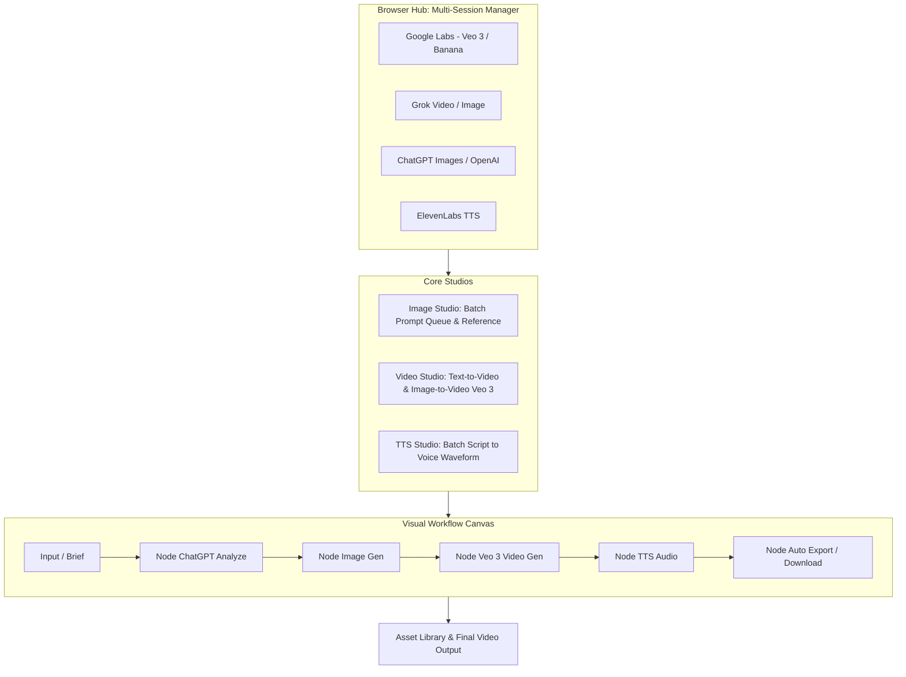

# AIForge Studio — Phân Tích & Đặc Tả Dự Án Tool Video Hub (Google Labs / Veo 3)

> **Website nguồn**: [https://aitoolforge.shop/](https://aitoolforge.shop/)  
> **Phiên bản ghi nhận**: AIForge Studio v0.1.0 (Build #20260828020720)  
> **Hệ điều hành hỗ trợ**: Windows 10/11 x64, macOS Apple Silicon (arm64), macOS Intel (x64)  
> **Thời gian tạo tài liệu**: 2026-08-30

---

## 1. TỔNG QUAN HỆ THỐNG (SYSTEM OVERVIEW)

**AIForge Studio** là giải pháp phần mềm Desktop tập trung vào quy trình sản xuất nội dung AI tự động hóa: *"Creative AI, forged into one workflow"* (Biến một ý tưởng thành cả dây chuyền nội dung).

Điểm cốt lõi là **kết nối trực tiếp với Web Hub của Google Labs (Veo 3 / Banana)** và các AI Provider khác thông qua **Browser Hub (đa tài khoản)**, kết hợp cùng tạo ảnh, kịch bản, giọng đọc (TTS) và liên kết thành chuỗi xử lý **Visual Node Canvas**.

---

## 2. CHI TIẾT CÁC MODULE CHỨC NĂNG

### 2.1. Browser Hub (Quản Lý Đa Phiên & Đa Tài Khoản)
- **Cơ chế hoạt động**: Tạo và duy trì các `Persistent Browser Context` riêng biệt cho từng tài khoản Google, Grok, ChatGPT, ElevenLabs mà không bị đăng xuất chéo.
- **Tính năng nổi bật**:
  - Tự động lưu trữ Cookies, Tokens và làm mới Captcha khi cần.
  - Hỗ trợ thêm nhiều tài khoản cho cùng một provider (Multi-account).
  - **Auto Assignment**: Tự động cân bằng tải và điều phối job đến các tài khoản đang ở trạng thái sẵn sàng (`Ready`).
  - Hỗ trợ bật/tắt (Toggle Enable/Disable) từng tài khoản khi cần bảo trì hoặc hạn mức.

---

### 2.2. Video Studio (Trọng Tâm Google Labs Veo 3 & Grok)
- **Tính năng cốt lõi**:
  - Tạo video từ văn bản (**Text-to-Video**) hoặc từ hình ảnh tham chiếu (**Image-to-Video / Keyframes**).
  - Hỗ trợ chọn Model (`Veo 3`, `Grok Video`), chỉnh Tỷ lệ khung hình (16:9, 9:16, 1:1), Thời lượng (Duration).
  - **Batch Prompt Queue**: Đưa danh sách nhiều prompt vào hàng đợi cùng lúc để tự động sinh video liên tục.
  - **Live Preview Results**: Trình phát video tích hợp sẵn, cho phép xem lại video vừa render, đối chiếu với prompt gốc, tải về hoặc re-generate nhanh.

---

### 2.3. Image Studio (Tạo Ảnh Hàng Loạt)
- Hỗ trợ ChatGPT Images, Google Flow, Grok.
- Nhập danh sách batch prompt -> Thiết lập provider, tỷ lệ, độ phân giải, số lượng ảnh và phân phối tài khoản.
- Hỗ trợ ảnh tham chiếu (Reference Assets) để duy trì tính nhất quán của nhân vật/sản phẩm.

---

### 2.4. TTS Studio (Chuyển Kịch Bản Thành Giọng Đọc)
- Chia kịch bản dài thành các phân đoạn (Script Batching).
- Tích hợp giọng đọc ElevenLabs (Adam, Rachel, v.v.).
- Điều chỉnh chuyên sâu: *Stability, Similarity, Speed, Style, Speaker Boost*.
- Hiển thị trực quan dạng sóng âm (Waveform Preview), xuất file định dạng MP3 / WAV.

---

### 2.5. Visual Workflow Builder (Tự Động Hóa Dạng Kéo Thả Canvas)
- Kết nối các node từ đầu vào đến thành phẩm:
  - **Input / Brief Node** -> **ChatGPT Analyze Node** (phân tích tối đa 4 ảnh) -> **Image Node** (hỗ trợ dán ảnh từ clipboard) -> **Veo 3 Video Node** -> **TTS Voice Node** -> **Download Node** (tự động đánh số và lưu an toàn).
- **Tính năng kiểm soát nâng cao**:
  - Hỗ trợ **Loop** (vòng lặp chiến dịch), **Retry** (tự động thử lại khi lỗi mạng), **Fallback** (chuyển sang provider dự phòng nếu provider chính bị giới hạn).
  - Giới hạn luồng song song (Concurrency limit) theo từng nhóm provider.
  - Tính năng dừng khẩn cấp an toàn (Safe Pause/Stop).
- **Workflow Store**: Thư viện mẫu quy trình có sẵn, hỗ trợ export/import và mã hóa bảo mật lưu trữ cục bộ.

---

### 2.6. Thư Viện Tài Nguyên (Asset Library) & Quản Lý Quota
- Quản lý tập trung mọi Ảnh, Video, Audio, Reference Assets.
- Tìm kiếm theo prompt, lọc theo provider, gắn tag và pin các asset quan trọng.
- Hệ thống Quota độc lập cho từng loại tài nguyên (Ảnh, Video, TTS) hiển thị trực tiếp theo thời gian thực trên Sidebar và cạnh nút hành động.

---

## 3. KIẾN TRÚC KỸ THUẬT ĐỂ TỰ XÂY DỰNG TOOL TƯƠNG TỰ

| Tầng kiến trúc | Công nghệ khuyên dùng | Vai trò & Trách nhiệm |
|---|---|---|
| **Frontend UI/UX** | React + Vite + Tailwind CSS / Vanilla CSS | Giao diện Dark Theme cao cấp, React Flow (Canvas node), Waveform Player, Video Queue Manager |
| **Backend & Scheduler** | Node.js (Express / Fastify) hoặc Python (FastAPI) | Điều phối hàng đợi tác vụ (Queue), quản lý concurrency, lưu trữ metadata SQLite / JSON |
| **Browser Hub Engine** | Playwright / Puppeteer (Chromium Persistent Context) | Tự động hóa đăng nhập Google Labs, bypass / refresh token, giữ phiên Veo 3 |
| **Veo 3 Reverse API** | Reverse Engineering WebSocket / HTTP POST | Bắt gói tin `generateVideo` của Google Labs, truyền prompt + image seed, polling lấy link MP4 tải về |
| **Media Processing** | FFmpeg Native | Ghép chuỗi video, mix audio giọng đọc TTS, resize khung hình, chèn phụ đề tự động |

---

## 4. KẾ HOẠCH BẮT TAY TRIỂN KHAI DỰ ÁN

1. **Khởi tạo mã nguồn**: Tạo cấu trúc thư mục hoàn chỉnh trong `D:\dự án antigravity\AIForge_Veo3_Studio\`.
2. **Xây dựng module Veo 3 Browser Hub**: Tự động quản lý profile Google Labs và cào/gửi lệnh tạo video Veo 3.
3. **Xây dựng giao diện Studio**: Image Studio, Video Studio (Batch Queue), TTS Studio.
4. **Tích hợp Workflow Engine**: Nối các bước thành 1 click tự động tạo video hoàn chỉnh từ prompt.
